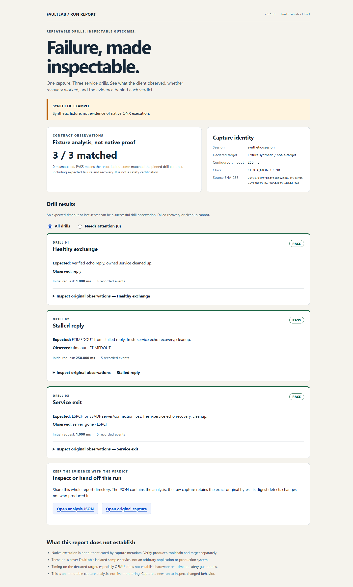

# QNX FaultLab
**Repeatable service-failure drills. Inspectable client outcomes.**

FaultLab pairs a small native QNX 8.0 example runner with a dependency-free Python host tool. It checks three pinned contracts—healthy exchange, stalled reply, and service exit—and creates an offline report with the original observations.

**Current validation:** the runner compiled with licensed QNX SDP 8.0 and passed three local QNX 8.0.0 x86_64/QEMU smoke runs, recovery, interruption and closed-pipe cleanup checks on November 3, 2026. The host analyzer/report also has automated and browser evidence. See the [native validation record](docs/native-validation.md), including the SDK verification finding and limits. This is a prototype, not a qualified fault-injection or safety tool.



## Try the host report
From this source directory, use Python 3.10 or newer (locally exercised with Python 3.12 on Windows):
```sh
python -m faultlab report samples/expected.synthetic.ndjson --out artifacts/first-report
```
Open artifacts/first-report/index.html in a browser. It needs no server, network, account or JavaScript. Keep summary.json and source.ndjson beside the HTML when sharing the report.

Try a deliberately mismatched recovery:
```sh
python -m faultlab report samples/failed-recovery.synthetic.ndjson --out artifacts/failed-example
```
This produces a report and exits **1**. An expected timeout can pass a drill; failed recovery cannot.

Choose a new output directory on every run. Existing files/directories and symbolic-link/junction output paths are refused, preserving prior work. No runtime dependency installation is needed.

## Run real QNX drills
See [native instructions](native/README.md) and the [official QNX QEMU guide](https://www.qnx.com/developers/docs/qnxeverywhere/com.qnx.doc.target_images/topic/qsti_qemu/about.html).
A licensed QNX SDP 8.0 toolchain and disposable QNX 8.0 target are required. The current QSTI/QEMU guide uses Ubuntu 22.04 or 24.04. Do not assume a Windows or WSL host is qualified merely because QEMU is available.

The native source:
- Creates only its own disposable example server processes and channels.
- Uses QNX MsgSend/MsgReceive/MsgReply and TimerTimeout for bounded observations.
- Recreates a fresh service/connection after the two failure drills.
- Emits ordered NDJSON; the smoke harness publishes a completed capture only after producer exit 0 and retains failed output separately.
- Offers no arbitrary PID/service/remote-command interface.

Use your own approved target console/copy workflow; FaultLab never collects SDK credentials or executes remote commands.

Inspect the retained native smoke capture without installing the SDK:
```sh
python -m faultlab report samples/native-smoke-20261103/capture.ndjson --out artifacts/native-example
```
Keep its neighboring producer exit receipt and target/version files. This replays a retained observation; it does not run QNX on your machine.

## Inspect without a report
```sh
python -m faultlab validate samples/expected.synthetic.ndjson
python -m faultlab --help
python -m unittest discover -v
```
Exit codes: **0** valid capture with matched contracts; **1** valid capture with a contract mismatch; **2** input/schema/IO/usage error. Codes 0/1 are not native-authenticity or production-readiness claims.

Input is bounded to 16 MiB and 10,000 records, with strict version, field, type, sequence and timing checks. Duplicate keys, nonfinite values, unsupported text, incomplete sessions and unknown schemas are rejected.

## Evidence and limits
The report retains exact capture bytes and their SHA-256. That detects changes; it does **not** authenticate who produced a capture. A qnx-native header is a producer declaration until the actual target/toolchain/run is independently checked. Files named synthetic are authored fixtures; samples/native-smoke-20261103 contains the retained local QNX run described in the validation record. Neither the header nor the host report authenticates that provenance by itself.

For native evidence, retain the entire smoke output, including native-exit-code.txt. A late failed/interrupted producer can leave structurally complete bytes; the canonical harness keeps those under capture.partial.ndjson rather than publishing capture.ndjson. A host contract verdict alone never certifies producer success.

Timing is measured on the declared target and does not establish hardware hard real-time guarantees. The three sample drills do not qualify an arbitrary service, kernel, production deployment, medical device or vehicle.

No runtime AI or external provider is used. Codex assisted design, source authoring, tests and documentation. No customer interviews, human usability study or measured productivity benefit has been completed.

## Source and maintenance
- [Native build and capture](native/README.md)
- [Capture format and architecture](docs/capture-format.md)
- [Source provenance](docs/provenance.md)
- [Security boundary](SECURITY.md)
- License: [MIT](LICENSE). QNX SDK, images and components remain under their own licenses and are not distributed here.
